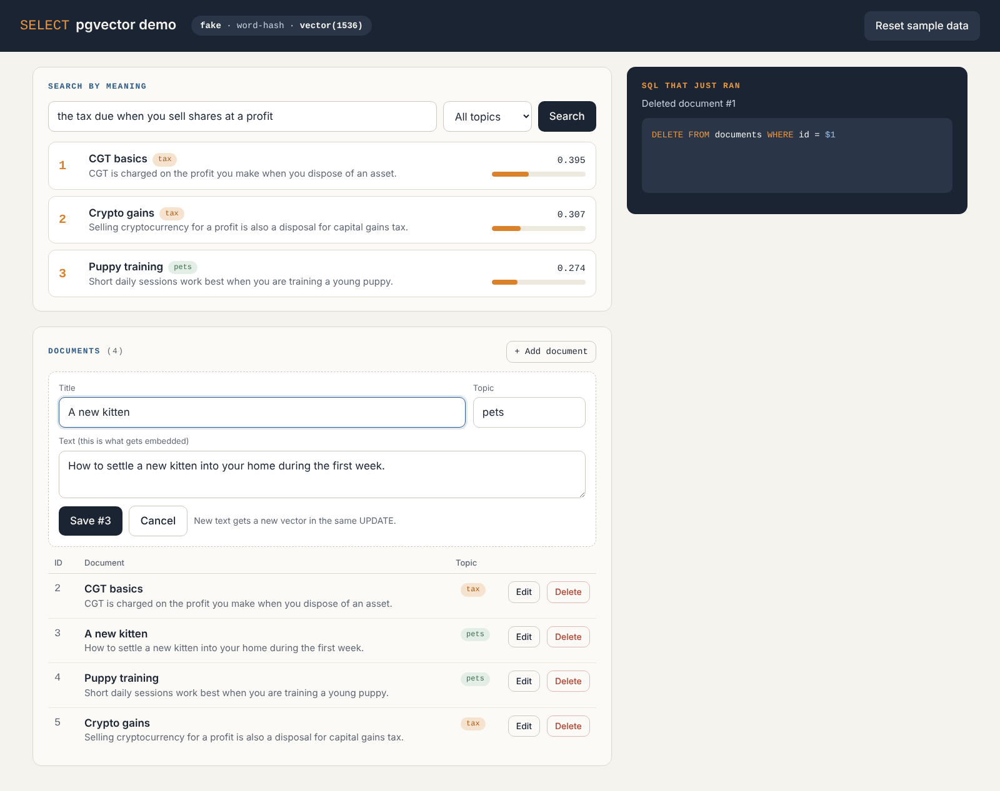
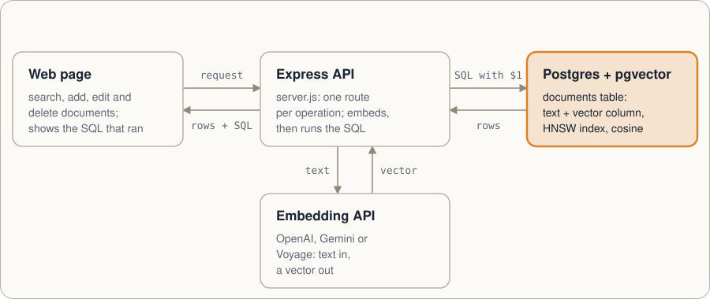

# PGVector demo

A small Node.js demo for "The Vector Database We Didn't Buy": create, read
(nearest-neighbour search), update and delete rows that carry an embedding,
plus a filtered search with iterative index scans. It comes as a simple web
page for recording and as a terminal script.



## Run it

```bash
docker compose up -d     # Postgres 17 + pgvector on host port 5433
npm install
cp .env.example .env     # then set the key for one embeddings provider
```

Needs Node 22.9 or later. The database is published on host port 5433 so it
does not clash with a Postgres already running on 5432. `.env` is read by every
npm script (`node --env-file-if-exists=.env`); variables set in the shell take
precedence, so the per-provider scripts below still work. Node does not expand
`${VAR}` references in `.env`, so put the key itself there, or export it in the
shell and leave the line out.

Both the database and the page listen on 127.0.0.1 only, so nobody else on a
conference network can reach them. Set `HOST=0.0.0.0` in `.env` if a second
machine really needs the page.

`npm test` runs the checks against the demo database with fake embeddings, so
it needs `docker compose up -d` but no API key.

Start the page and open http://localhost:3000:

| Provider | Model | Dimensions | Key | Web page | Terminal |
|---|---|---|---|---|---|
| OpenAI | `text-embedding-3-small` | 1536 | `OPENAI_API_KEY` | `npm start` | `npm run demo` |
| Google Gemini | `gemini-embedding-001` | 1536 (via `outputDimensionality`) | `GEMINI_API_KEY` | `npm run start:gemini` | `npm run demo:gemini` |
| Voyage AI | `voyage-4` | 1024 | `VOYAGE_API_KEY` | `npm run start:voyage` | `npm run demo:voyage` |
| None (testing) | word hashing | 1536 | none | `npm run start:fake` | `npm run demo:fake` |

## How it works



Search, insert and update call the embedding model first, because the text has
to become a vector before Postgres can store or compare it. Delete and list go
straight to the database. Everything lives in one `documents` table.

## The web page

- **Search by meaning:** type a question, optionally limit it to one topic,
  and see the three nearest documents with a similarity bar.
- **Documents:** add, edit and delete rows. After every change, the last
  search runs again, so the audience sees the effect straight away.
- **SQL that just ran:** the exact statement behind the last action, with the
  time spent embedding and querying.
- **Reset sample data** recreates the table with the five sample documents.

A suggested 2-minute flow: search "the tax due when you sell shares at a
profit" → edit *Pizza dough* into a crypto-gains tax note and watch it join
the results → delete *Selling shares* → pick "Only pets" and search "looking
after a young cat" to show the filtered query.

Anthropic does not offer its own embedding model; its documentation points to
Voyage AI. So a Claude-based app would typically embed with Voyage and chat
with Claude.

Voyage keys created in MongoDB Atlas use a different address:
`export VOYAGE_BASE_URL=https://ai.mongodb.com/v1`.

`demo:fake` proves the SQL and plumbing work, but it only matches shared words,
so don't record with it: the point of the talk is that real embeddings match
meaning.

## Why the table is created by the demo

The vector size is part of the column type, and each provider returns a
different size. The server creates `documents` with `vector(<dimensions>)` for the chosen
provider (and recreates it with sample data if it was built for a different
size); the terminal demo recreates it on every run.
Vectors from different models can't be mixed in one column anyway: switching
models means re-embedding everything.

Gemini's default is 3072 dimensions, which is over pgvector's HNSW limit of
2,000 for `vector`, so the demo asks for 1536 and normalises the result, as
Google's docs require below 3072.

## Files

| File | What it shows |
|---|---|
| `db/init.sql` | Enables the `vector` extension when the database is created |
| `src/db.js` | A `pg` pool that runs `registerTypes` in `onConnect` |
| `src/embed.js` | One `embed()` for all providers; documents and queries flagged separately |
| `src/documents.js` | Table setup, the four CRUD functions and their SQL |
| `src/server.js` | A small Express API for the page: one route per operation |
| `public/index.html` | The page: plain HTML, CSS and JavaScript, no build step |
| `src/demo.js` | The same steps as a terminal script |

## What happens

1. **Create:** five short documents (two about tax, two about pets, one
   about pizza) are embedded in one API call and inserted.
2. **Read:** "the tax due when you sell shares at a profit" returns the
   three nearest documents with a cosine similarity (1 − distance).
3. **Update:** the pizza row is rewritten as a crypto-gains tax note. The new
   text gets a new vector in the same `UPDATE`, and the row now shows up in
   the tax search.
4. **Delete:** "Selling shares" is removed; the vector goes with the row.
5. **Bonus:** a pets-only search inside a transaction with
   `SET LOCAL hnsw.iterative_scan = strict_order`, the fix for the filtering
   trap. Needs pgvector 0.8 or later; on older versions it prints a message
   and skips.

With only five rows, Postgres will usually scan the table instead of using
the index, so the results are exact. That's fine for showing the API; the
index matters from thousands of rows up.
